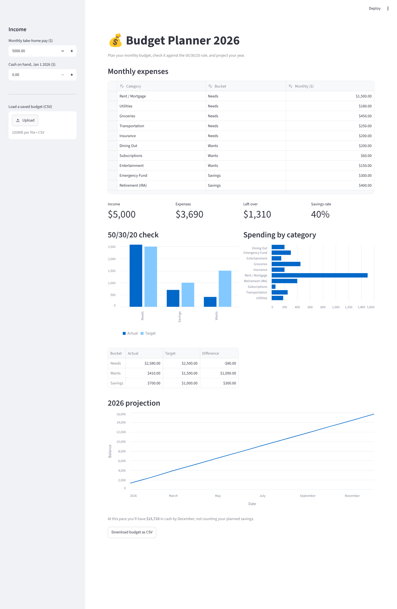

# 💰 Budget Planner 2026

[](https://github.com/dtbakes/Budget_Planner/actions/workflows/tests.yml)

A small personal budgeting app built with [Streamlit](https://streamlit.io) and pandas. Enter your monthly take-home pay and expenses, see how your spending stacks up against the 50/30/20 rule, and get a month-by-month projection for 2026.



## Features

- **Editable expense table**: add, remove, or change categories and tag each one as a Need, Want, or Savings.
- **At-a-glance metrics**: income, total expenses, money left over, and savings rate, with a warning when you're over budget.
- **50/30/20 check**: compares what you spend in each bucket against the classic 50% needs / 30% wants / 20% savings guideline.
- **2026 projection**: charts how your cash balance grows (or shrinks) across the year.
- **Save and load**: download your budget as CSV and upload it again later.

## Run it locally

Requires Python 3.11+.

```bash
git clone https://github.com/dtbakes/Budget_Planner.git
cd Budget_Planner
pip install -r requirements.txt
streamlit run streamlit_app.py
```

The app opens at http://localhost:8501. You can also open the repo in GitHub Codespaces; the dev container installs everything and starts the app for you.

## Tests

```bash
pip install -r requirements-dev.txt
pytest
```

The budgeting math lives in `budget.py` as plain functions, separate from the UI in `streamlit_app.py`, so it can be unit tested directly. There's also a smoke test that runs the full app with Streamlit's `AppTest`. Tests run on every push and pull request via GitHub Actions on Python 3.11 to 3.13.

## Project layout

```
budget.py            # budgeting logic (summaries, 50/30/20 breakdown, yearly projection)
streamlit_app.py     # Streamlit UI
tests/               # pytest suite
docs/screenshot.png  # README screenshot
```

## License

Apache 2.0, see [LICENSE](LICENSE).
